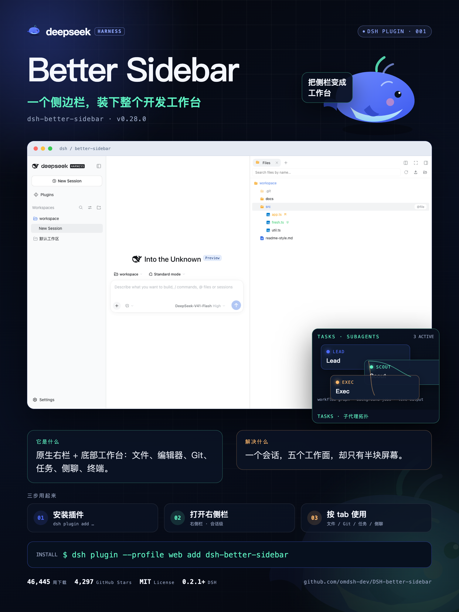

<div align="center">

# DSH Reel Studio

### 从插件介绍，到一条宣传片与一张宣传图。

面向 DeepSeek Harness（DSH）插件的本地 Remotion 宣传素材原型。<br />
从可编辑案例与截图出发，生成横屏视频、视频封面和竖版宣传图；当前内置 Better Sidebar 示例模板。


**[下载源码](https://github.com/Eileenes/dsh-reel/archive/refs/heads/main.zip)** · **[快速开始](#quick-start)** · **[观看样片](docs/demo.mp4)** · **[编辑案例](#cases)** · **[插件接入](#host-plugin)**

</div>

---

## 能做什么

| 宣传片 | 宣传图与封面 | 本地工作流 |
| --- | --- | --- |
| 32.5 秒、1920×1080、30fps 的横屏视频模板 | 2160×2880 PNG 宣传图 | 通过 JSON 配置插件信息、功能卡片和宣传文案 |
| 引入、问题、方案、功能、用法、数据、片尾共七段 | 从视频指定帧导出 1920×1080 封面 | CLI 分别导出视频、图片或全部产物 |
| 程序化 BGM、字幕、截图与合成界面 | DSH 风格配色、网格和卡通鲸鱼 | `--dry-run` 先生成渲染参数，不启动渲染 |

**当前是可运行的示例原型。** 仓库包含现成样片和渲染代码，但多个镜头仍写死 Better Sidebar 的内容；换成其他插件时，需要同时修改案例和模板代码。DSH 宿主插件尚未在真实 profile 中验证。

## 样片与素材

[观看约 32.5 秒的宣传片](docs/demo.mp4) · [查看宣传图](docs/promo.png) · [查看视频封面](docs/poster.png)



示例介绍的是 [omdsh-dev/DSH-better-sidebar](https://github.com/omdsh-dev/DSH-better-sidebar)，不是本仓库自身的功能。原仓库说明记录：截图来自该 MIT 许可项目，任务与侧边对话面板使用合成界面。案例里的版本、下载量和 Stars 是静态示例数据，不会自动更新。

<a id="quick-start"></a>

## 快速开始

### 1. 准备环境并安装渲染依赖

需要 **Node.js 22+、pnpm 和 Chrome／Chromium**。下面的命令在仓库的 `studio/` 中安装 Remotion 依赖；单独渲染示例无需先接入 DSH。

```bash
git clone https://github.com/Eileenes/dsh-reel.git
cd dsh-reel/studio
pnpm install
cd ..
```

CLI 会检查 macOS、Windows 与 Linux 的常见 Chrome 路径。浏览器不在这些位置时，可设置 `CHROME_PATH`；以下是 macOS shell 示例：

```bash
export CHROME_PATH="/Applications/Google Chrome.app/Contents/MacOS/Google Chrome"
```

未找到浏览器时，CLI 会使用 Remotion 的默认浏览器处理方式。首次安装依赖或获取浏览器可能需要联网。

### 2. 检查案例，再渲染

在仓库根目录执行：

```bash
# 只检查基础字段并生成 props，不渲染
node scripts/reel.mjs --case cases/dsh-better-sidebar.json --dry-run

# 生成视频、视频封面和宣传图
node scripts/reel.mjs --case cases/dsh-better-sidebar.json --mode both
```

也可以分别生成：

```bash
# 视频和视频封面
node scripts/reel.mjs --case cases/dsh-better-sidebar.json --mode video

# 仅宣传图
node scripts/reel.mjs --case cases/dsh-better-sidebar.json --mode image
```

### 3. 查看结果并检查内容

产物写入 `studio/out/`。文件名前缀取自 `plugin.handle`，未提供时使用 `plugin.name`，再转换成小写英文、数字和连字符。

| 文件 | 用途 |
| --- | --- |
| `props-<slug>.json` | 本次使用的案例参数；dry-run 也会生成 |
| `<slug>-demo.mp4` | H.264 视频，包含配乐 |
| `<slug>-poster.png` | 视频封面，默认第 825 帧 |
| `<slug>-promo.png` | 按 2 倍尺寸导出的宣传图 |

使用 `--poster-frame 825` 可指定封面帧；当前视频的有效帧为 `0–974`。同一文件名前缀再次渲染会覆盖已有结果，请先保存需要保留的版本。发布前逐帧检查文案、截图、数字、安装命令与授权信息。

<a id="cases"></a>

## 编辑案例与模板

以 [现有案例](cases/dsh-better-sidebar.json) 为起点复制一份 JSON，然后修改字段：

| 区域 | 内容 | 注意事项 |
| --- | --- | --- |
| `plugin` | 名称、英文 handle、版本、地址、安装命令、标语、下载量、Stars | 数字由案例提供，不会联网核实；`repo` 用于画面展示 |
| `features` | 功能编号、标题、说明、配色及截图或 mock | 当前布局按四张功能卡片设计；改变数量需检查布局 |
| `promo` | 问题、产品介绍、操作步骤与地址 | 宣传图读取这些字段；视频只读取其中部分字段 |

功能截图的 `img` 路径相对 `studio/public/`，例如 `shots/files-tree.png`；内置 `mock` 可选 `tasks` 或 `sidechat`。完整字段形状见 [数据类型与默认值](studio/src/data.ts)。CLI 只校验 `plugin.name`、非空 `features` 和 `promo.address`，通过 dry-run 不代表其他字段、素材或画面已经完整。

**案例配置尚未覆盖整个画面。** [视频模板](studio/src/PluginDemo.tsx) 和 [宣传图模板](studio/src/PromoCard.tsx) 中仍有固定标题、侧栏文案、截图路径、MIT 标签和 DSH 版本文字；宣传图主截图也不是从 `features` 读取。为其他项目制作素材时，请逐项替换这些内容，不能仅更改 JSON 就直接发布。

**已核实的介绍与截图 → 案例 JSON → 模板适配 → 本地渲染 → 内容与画面检查**

<a id="host-plugin"></a>

## DSH 宿主接入

仓库通过 [`cordis.patch.yml`](cordis.patch.yml) 和 `package.json` 中的 `dsh.bundle` 声明宿主入口，工具实现在 [`lib/index.js`](lib/index.js)。

| 工具 | 当前实现 |
| --- | --- |
| `reel_scan` | 读取本地 `package.json`，检测部分 README 文件名是否存在，列出 `docs/screenshots`、`assets`、`preview` 中的顶层图片 |
| `reel_plan` | 将名称、简介和数据点填入固定的七段分镜对象；引入、问题与用法仍是侧栏示例文案 |
| `reel_render` | 调用本地 CLI，根据案例文件渲染视频、图片或全部产物 |

`reel_scan` **不会解析 README 正文或自动提取卖点**；`reel_plan` 的分镜结果也未自动转换为渲染案例。这些工具尚未构成“给一个仓库地址就自动出片”的完整流程。

原说明提供了以下 GitHub 安装方式，仅供在测试 profile 中验证：

```bash
dsh plugin --profile scratch add github:Eileenes/dsh-reel
```

宿主运行还依赖兼容的 `@deepseek-ai/dsh-tools`、Remotion 和浏览器。**真实 DSH profile 的安装、加载、工具返回值、热更新与卸载仍待验证**，不据包声明推断已经兼容所有 DSH 版本或已经发布到 npm。

## 使用条件与当前限制

| 场景 | 需要什么 | 当前状态 |
| --- | --- | --- |
| 渲染内置示例 | Node.js 22+、pnpm、Chrome／Chromium | 仓库包含 MP4、封面与宣传图成品及相应源码 |
| 换成其他插件 | 已核实的信息、可使用的截图、JSON 与 TSX 修改 | 模板仍含 Better Sidebar 固定内容，需要人工适配 |
| 调整画幅或时长 | 修改 Composition、布局、镜头时间线和配乐 | 目前固定 16:9 视频和 3:4 宣传图；无通用竖屏或方形预设 |
| 重新生成 BGM | Python 3 | 可运行 `python3 studio/scripts/make_bgm.py`，会覆盖内置 `bgm.wav` |
| 旁白与宿主自动化 | 额外实现与验证 | 当前没有旁白生成，宿主流程未完成真实环境验收 |

现有样片为 H.264 视频与 AAC 双声道音轨，视频时间线是 975 帧／30fps。仓库没有独立自动化测试套件；dry-run 只检查参数路径，不能替代完整渲染和画面验收。

## 文档与维护

| 文档或入口 | 内容 |
| --- | --- |
| [案例 JSON](cases/dsh-better-sidebar.json) | 内置 Better Sidebar 示例数据 |
| [渲染 CLI](scripts/reel.mjs) | 参数、浏览器查找与输出路径 |
| [Composition 定义](studio/src/Root.tsx) | 视频时长、帧率与两种画幅 |
| [发布检查清单](PUBLISHING.md) | npm 打包与 DSH 市场发布的原始规划 |
| [原中文说明](README.zh-CN.md) | 原型制作与初版使用记录 |

发布清单中关于根目录 `package.json` 的 `private: true` 描述已过时：当前根包是 `private: false`，`studio` 子包仍是私有包。原中文说明中的“扫描／规划自动化”应结合上面的实际实现理解。打包状态以当前配置为准，发布和兼容性仍需要单独验证。

<details>
<summary><b>目录结构</b></summary>

```text
dsh-reel/
├── README.md                 # 介绍、使用与当前边界
├── lib/index.js              # DSH 宿主工具
├── cordis.patch.yml          # DSH 插件配置入口
├── scripts/reel.mjs          # 本地渲染 CLI
├── cases/                    # 案例 JSON
├── docs/                     # 样片、视频封面与宣传图
├── studio/
│   ├── src/                  # Remotion 组件、模板与数据类型
│   ├── public/               # 截图与配乐
│   └── scripts/make_bgm.py   # 程序化配乐脚本
├── PUBLISHING.md             # 原始发布检查清单
└── LICENSE                   # MIT 许可证
```

</details>

遇到问题可[提交 Issue](https://github.com/Eileenes/dsh-reel/issues)，附上 Node.js、浏览器、运行命令和脱敏后的错误信息。

## 来源与授权

项目代码采用 [MIT 许可证](LICENSE)，版权声明为 `2026 dsh-reel-studio contributors`。第三方截图、名称和标识的使用仍需遵守各自授权条件；适配新案例时请使用自己的素材或已获许可的素材。

这是非官方社区项目，与 DeepSeek 无隶属或背书关系。“DeepSeek”“DSH”等名称用于描述兼容目标，相关标识归其所有者。原说明将卡通鲸鱼标注为原创插画，并非官方 Logo；任务与侧边对话画面是合成示例。
