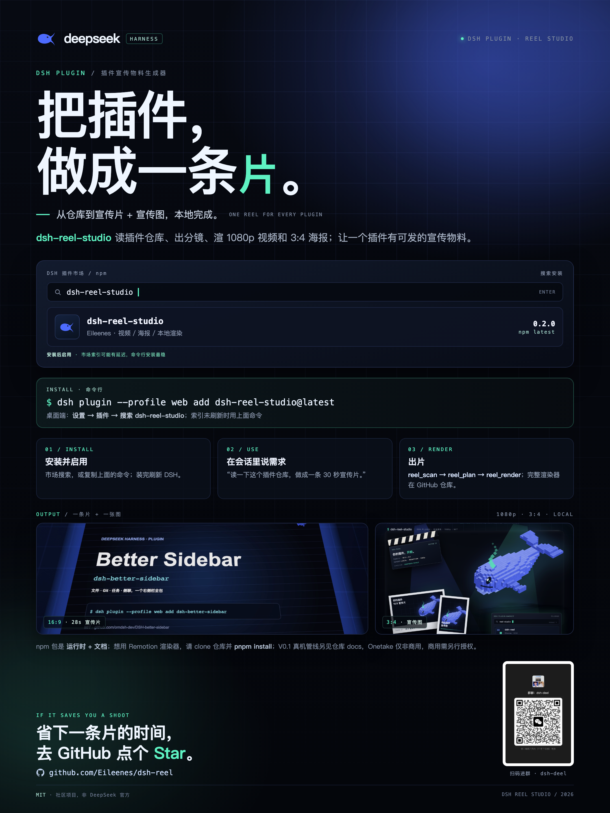
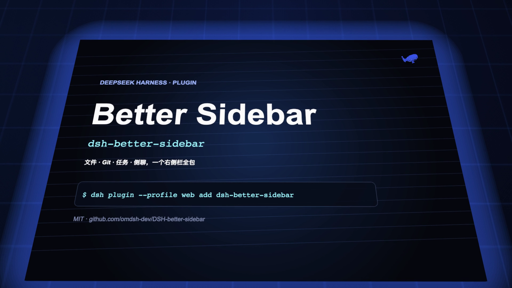
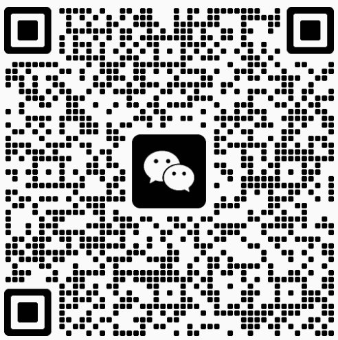

<div align="center">

# DSH Reel Studio

### 输入插件名，拍一条能安利人的真机片。

面向 DeepSeek Harness（DSH）插件的宣传素材工具：<br />
0.4.0 起自带「插件宣传台」面板，输入插件名称即可用 V0.1 真机管线生成 28 秒宣传片（真实界面截图 + 真实安装流程 + 四个功能页）与封面；也保留 Remotion 模板管线，生成 16:9 视频、3:4 海报和方图。


**[下载源码](https://github.com/Eileenes/dsh-reel/archive/refs/heads/main.zip)** · **[快速开始](#quick-start)** · **[观看 24 秒样片](https://github.com/Eileenes/dsh-reel/blob/main/docs/demo.mp4)** · **[查看安装海报](https://github.com/Eileenes/dsh-reel/blob/main/docs/install-poster.png)** · **[编辑案例](#cases)** · **[插件接入](#host-plugin)**

</div>

---

## 插件宣传台（Web UI · 0.4.0）


输入插件名称 → 匹配案例 → 生成 28 秒真机片。**安利墙 + 生成台**两视图：墙上每个案例一张卡（成片封面 + 功能页叠图 + 出片状态），生成台三栏展示目标插件、封面/功能页、6 格分镜与成片播放器；底部 dockbar 显示真实阶段（素材与音效 → 渲染 840 帧 → 混流 → 封面），任务可随时终止或重新生成。右上角 `?` 或输入框下的「怎么用？完整说明」有完整四步说明；没有现成案例时，把插件名交给 AI 按 SOP 收截图、写案例后再出片。

```sh
# 在 DSH 里安装（<profile> 换成你的 profile，如 desktop；当前版本 0.5.1）
dsh plugin --profile <profile> add dsh-reel-studio@latest
```

> **装的时候请带 `@latest`。** 第三方插件目录（dshmarket / dsh.so）里的条目版本刷新滞后：目录里可能仍显示 `0.2.1`，直接按目录版本装会装到旧版（0.2.1 存在 `output.render` 返回裸字符串导致三个宿主工具全挂的问题，0.4.0 已修）。显式 `@latest` 或 `@0.5.1` 即可。
>
> npm 包带面板、v1 Remotion 渲染和 **V0.1 真机片渲染器**（`tools/v01-film/render-frames.mjs`）。V0.1 只需要本机有 **Chrome/Chromium + ffmpeg**：comp 模板依赖的 27 个素材随包分发，首次运行会自动铺到工作目录，不再需要 Onetake 运行时。详见下文「插件宣传台面板（Web UI）」。

## 能做什么

| 2026 campaign（v2） | 案例模板（v1） | 本地工作流 |
| --- | --- | --- |
| 24 秒、1920×1080、30fps 品牌宣传片 | 32.5 秒横屏视频模板（case JSON 驱动） | 全部素材在本机 Remotion / Chrome 内渲染 |
| 2160×2880 海报、1920×1080 封面、1080×1080 方图 | 2160×2880 宣传图 + 从视频导出的 16:9 封面 | CLI 分别导出视频、图片或全部产物 |
| 体素鲸鱼、DSH 插件市场真实界面、事件音效 | 七段结构、程序化 BGM、截图与合成界面 | `--dry-run` 先生成渲染参数，不启动渲染 |

**两条管线并存：**

- **v2 campaign（新）**：`studio/src/v2/` 下的品牌片与海报系统，默认讲 dsh-reel-studio 自己的故事（在 DSH 里搜插件 → 安装 → 读仓库 → 写分镜 → 出片），画面使用暗色 DSH 插件市场 UI 与体素鲸鱼。海报/封面由 [`design/`](https://github.com/Eileenes/dsh-reel/blob/main/design/README.md) 的 HTML 模板生成。
- **v1 案例模板**：`studio/src/PluginDemo.tsx` + `cases/*.json`，用于把某个插件的资料套进固定 32.5 秒模板；仍需要人工适配部分镜头（见[编辑案例](#cases)）。

**当前是可运行的示例项目，不是"给个仓库地址就自动出片"的成品。** 宿主工具（`reel_scan` / `reel_plan` / `reel_render`）仍是脚手架能力；v2 campaign 目前是 dsh-reel 自己的品牌物料，参数化到任意插件是下一步路线。

**新增案例（2026-11-08）：Sorenyeah home film · 38 秒。** 第一条以**网站**为对象的片子，开场把用户自己的鲸鱼参考片（`Soren_DeepSeek_whale.mp4`）用本仓库的体素鲸鱼重做成 3D 1080p：终端打字 → 278 个体素拼出鲸鱼 → 跳到站点 App 图标上（图标下压、发光）→ 真实主页窗口从图标后面升起，镜头推进页面；之后接二进制名字 → 首页 / 音乐 / 作品的真实页面 → 四个项目 → 七首歌与三篇文章 → 联系方式 → 片尾。代码在 `studio/src/sorenyeah/`，素材在 `studio/public/sorenyeah/`，音乐是 `make_music_v2.py` 的 `38` 档（120 BPM、19 小节），音效由 `studio/scripts/make_home_audio.py` 生成（64 个事件）。方法、时间线与限制见 [案例拆解](https://github.com/Eileenes/dsh-reel/blob/main/docs/case-sorenyeah-home.md)；运行 `npm run home:audio && npm run home:render` 出片。

## 样片与素材

[观看 24 秒 campaign 片](https://github.com/Eileenes/dsh-reel/blob/main/docs/demo.mp4) · [3:4 安装海报](https://github.com/Eileenes/dsh-reel/blob/main/docs/install-poster.png) · [16:9 封面](https://github.com/Eileenes/dsh-reel/blob/main/docs/poster.png) · [1:1 方图](https://github.com/Eileenes/dsh-reel/blob/main/docs/promo-1x1.png) · [关键帧](https://github.com/Eileenes/dsh-reel/tree/main/docs/stills/)



新版 campaign 讲的是 dsh-reel-studio 自己：在 DSH 插件市场里搜到它、安装、让它把一个插件仓库读成一条片子和一张图。片中市场界面按真实 dshmarket / DSH 插件页结构重建，文案逐字取自已核对文案；**不包含伪造的下载量、星数或"官方认证"**。

v1 案例模板的旧示例介绍的是 [omdsh-dev/DSH-better-sidebar](https://github.com/omdsh-dev/DSH-better-sidebar)（MIT 许可，截图来自该仓库，任务/侧边对话面板为合成界面）；案例里的下载量与 Stars 是静态示例数据。

## V0.1 真机界面宣传片管线（Better Sidebar）

2026-11 新增：以**目标插件的真实界面**为主、30 秒以内的宣传片方法。首个案例是 Better Sidebar（MIT，截图来自其官方仓库）。

- [28 秒成片](https://github.com/Eileenes/dsh-reel/blob/main/docs/better-sidebar-v0.1.mp4)（1080p / 30fps / 带声音）
- [方法总结](https://github.com/Eileenes/dsh-reel/blob/main/docs/promo-method-v0.1.md)：读插件 → 定分镜 → 收干净素材 → 侧栏壳 → 鲸鱼运动 → 声音 → QA
- [案例拆解](https://github.com/Eileenes/dsh-reel/blob/main/docs/case-better-sidebar-v0.1.md)：功能表、28s 时间线、素材来源、已知限制
- [Onetake comp 参考](https://github.com/Eileenes/dsh-reel/blob/main/promo/comp-better-sidebar.html)：实际分镜/动画代码（依赖 Onetake 运行时，不随仓库分发）

### 按插件名出片（标准流程）

以后只给插件名/仓库，就按同一套流程出片（28s / 1080p / 30fps，结构和参考片一致）：

- [标准流程 SOP](https://github.com/Eileenes/dsh-reel/blob/main/docs/v01-film-sop.md)：收数据 → 写案例 JSON → 一条命令生成 comp/素材/音效 → 渲染 840 帧 → 混流 → QA
- 生成器：[tools/v01-film/make-v01-film.mjs](https://github.com/Eileenes/dsh-reel/blob/main/tools/v01-film/make-v01-film.mjs)（模板 [comp-template.html](https://github.com/Eileenes/dsh-reel/blob/main/tools/v01-film/comp-template.html)）
- 渲染器：[tools/v01-film/render-frames.mjs](https://github.com/Eileenes/dsh-reel/blob/main/tools/v01-film/render-frames.mjs)：驱动本机 Chrome 逐帧截图，快门区间多采样、在线性光下积分（运动模糊），再做硬切保护，最后 x264 编码；`--sfx` 可一步混流。只依赖 node + Chrome + ffmpeg + `puppeteer-core`，**不需要 Onetake**
- 案例：[cases/v01/dsh-guizang-design.json](https://github.com/Eileenes/dsh-reel/blob/main/cases/v01/dsh-guizang-design.json)；成片按 SOP 在本地生成（`studio/out/promo-<slug>-intro-1080.mp4`，不随仓库分发）

### 安装 / 使用海报

[](https://github.com/Eileenes/dsh-reel/blob/main/docs/install-poster.png)

3:4 · 2160×2880：插件市场搜索、命令行安装、三步使用、Star 入口和微信群二维码。源文件在 [`design/install-poster.html`](https://github.com/Eileenes/dsh-reel/blob/main/design/install-poster.html)。



> 这条管线的**渲染**已经自包含（本机 Chrome 出帧，见上）；但**分镜与素材**仍需按目标插件逐个准备：四张真实界面截图、tab 文案、音效事件都来自案例 JSON，不是“给仓库地址就自动出片”。

### Onetake 许可说明（可选路径）

默认渲染路径是仓库自己的 `tools/v01-film/render-frames.mjs`，不含任何第三方渲染运行时。若本机恰好有 Onetake，仍可用 `--engine onetake` 走参考实现（输出对帧一致，差异只在字形抗锯齿）：

- 本仓库里的 Onetake comp / 工作流，**仅用于开发和制作 DSH 插件相关的宣传素材**；
- **Onetake 本身不是商用授权**：它是 PolyForm Noncommercial 许可，只能用于非商业用途；
- 任何人如果要把 Onetake 或其渲染产物用于**商业用途**，需要自行向 Onetake 作者取得**另行商业授权**；
- 本仓库不包含、也不分发 Onetake 运行时；商用前请同时确认截图、字体、音乐等全部素材的许可。

## 交流群

对 dsh-reel-studio 感兴趣、想反馈问题或一起做插件宣传片，可以扫码进群：



群聊：`dsh-deel` · 二维码 7 天内有效（11 月 11 日前）

<a id="quick-start"></a>

## 快速开始

### 1. 准备环境并安装渲染依赖

需要 **Node.js 22+、pnpm 和 Chrome／Chromium**。下面的命令在仓库的 `studio/` 中安装 Remotion 依赖；单独渲染示例无需先接入 DSH。

```bash
git clone https://github.com/Eileenes/dsh-reel.git
cd dsh-reel/studio
pnpm install
cd ..
```

CLI 会检查 macOS、Windows 与 Linux 的常见 Chrome 路径。浏览器不在这些位置时，可设置 `CHROME_PATH`；以下是 macOS shell 示例：

```bash
export CHROME_PATH="/Applications/Google Chrome.app/Contents/MacOS/Google Chrome"
```

未找到浏览器时，CLI 会使用 Remotion 的默认浏览器处理方式。首次安装依赖或获取浏览器可能需要联网。

### 2. 渲染 2026 campaign（v2，推荐先看这个）

```bash
# 24 秒品牌片（1920×1080 / 30fps）
cd studio
node_modules/.bin/remotion render src/v2/entry.tsx ReelPromo out/reel-promo.mp4 \
  --codec h264 --crf 16 --concurrency=1
cd ..

# 海报 / 封面 / 方图（HTML 模板 → headless Chrome → docs/）
bash design/build.sh
```

> 本机 macOS 上 3D 场景走 ANGLE/Metal；`remotion.config.ts` 已设置 `setChromiumOpenGlRenderer('angle')`。
> 1080p 全片建议 `--concurrency=1`，4 并发在 24GB 机器上会 OOM。
>
> 音轨 `studio/public/audio/v2/preview-mix.mp3` 已随仓库提供：**120 BPM 卡点 BGM（A 小调，Am–F–C–G）
> + 事件驱动音效**，两条 24s 片共用。重做声音：
> ```bash
> python3 studio/scripts/make_music_v2.py          # -> public/audio/v2/music-bed.wav
> python3 studio/scripts/make_sfx_v2.py \
>   --music public/audio/v2/music-bed.wav \
>   --mix out/p1-audio-mix.wav
> ffmpeg -i out/p1-audio-mix.wav -b:a 192k public/audio/v2/preview-mix.mp3
> ```
> 没有音乐时 `make_sfx_v2.py` 仍会退回到原来的 drone + 音效版本。

### 3. 检查案例，再渲染（v1 模板）

在仓库根目录执行：

```bash
# 只检查基础字段并生成 props，不渲染
node scripts/reel.mjs --case cases/dsh-better-sidebar.json --dry-run

# 生成视频、视频封面和宣传图
node scripts/reel.mjs --case cases/dsh-better-sidebar.json --mode both
# 面板同款：额外逐张渲染分镜图（studio/out/storyboard/）
node scripts/reel.mjs --case cases/dsh-better-sidebar.json --mode both --storyboard
```

也可以分别生成：

```bash
# 视频和视频封面
node scripts/reel.mjs --case cases/dsh-better-sidebar.json --mode video

# 仅宣传图
node scripts/reel.mjs --case cases/dsh-better-sidebar.json --mode image
```

### 4. 查看结果并检查内容

产物写入 `studio/out/`。文件名前缀取自 `plugin.handle`，未提供时使用 `plugin.name`，再转换成小写英文、数字和连字符。

| 文件 | 用途 |
| --- | --- |
| `props-<slug>.json` | 本次使用的案例参数；dry-run 也会生成 |
| `<slug>-demo.mp4` | H.264 视频，包含配乐 |
| `<slug>-poster.png` | 视频封面，默认第 825 帧 |
| `<slug>-promo.png` | 按 2 倍尺寸导出的宣传图 |

使用 `--poster-frame 825` 可指定封面帧；当前视频的有效帧为 `0–974`。同一文件名前缀再次渲染会覆盖已有结果，请先保存需要保留的版本。发布前逐帧检查文案、截图、数字、安装命令与授权信息。

CLI 其他参数：`--out <dir>` 指定输出目录（默认 `studio/out`，相对路径按当前目录解析），`--help` 查看全部参数。`plugin.handle`/`plugin.name` 只含非 ASCII 字符时会生成 `plugin-<hash>` 前缀，避免空文件名；坏 JSON 或缺失文件会打印可读错误并以非零码退出。

<a id="cases"></a>

## 编辑案例与模板

以 [现有案例](https://github.com/Eileenes/dsh-reel/blob/main/cases/dsh-better-sidebar.json) 为起点复制一份 JSON，然后修改字段：

| 区域 | 内容 | 注意事项 |
| --- | --- | --- |
| `plugin` | 名称、英文 handle、版本、地址、安装命令、标语、下载量、Stars | 数字由案例提供，不会联网核实；`repo` 用于画面展示 |
| `features` | 功能编号、标题、说明、配色及截图或 mock | 当前布局按四张功能卡片设计；改变数量需检查布局 |
| `promo` | 问题、产品介绍、操作步骤与地址 | 宣传图读取这些字段；视频只读取其中部分字段 |

功能截图的 `img` 路径相对 `studio/public/`，例如 `shots/files-tree.png`；内置 `mock` 可选 `tasks` 或 `sidechat`。完整字段形状见 [数据类型与默认值](https://github.com/Eileenes/dsh-reel/blob/main/studio/src/data.ts)。CLI 只校验 `plugin.name`、非空 `features` 和 `promo.address`，通过 dry-run 不代表其他字段、素材或画面已经完整。

**案例配置尚未覆盖整个画面。** [视频模板](https://github.com/Eileenes/dsh-reel/blob/main/studio/src/PluginDemo.tsx) 和 [宣传图模板](https://github.com/Eileenes/dsh-reel/blob/main/studio/src/PromoCard.tsx) 中仍有固定标题、侧栏文案、截图路径、MIT 标签和 DSH 版本文字；宣传图主截图也不是从 `features` 读取。为其他项目制作素材时，请逐项替换这些内容，不能仅更改 JSON 就直接发布。

**v2 campaign 与 v1 案例是两套模板。** `studio/src/v2/` 的 24 秒片、海报与封面目前为 dsh-reel-studio 自身定制，数据与文案集中在 `src/v2/data/`、`src/v2/scenes/`；把 campaign 参数化到任意插件（由 case JSON 驱动镜头与文案）是下一阶段工作，尚未完成。

**已核实的介绍与截图 → 案例 JSON → 模板适配 → 本地渲染 → 内容与画面检查**

<a id="host-plugin"></a>

## DSH 宿主接入

仓库通过 [`cordis.patch.yml`](https://github.com/Eileenes/dsh-reel/blob/main/cordis.patch.yml) 和 `package.json` 中的 `dsh.bundle` 声明宿主入口，工具实现在 [`lib/index.js`](https://github.com/Eileenes/dsh-reel/blob/main/lib/index.js)。

| 工具 | 当前实现 |
| --- | --- |
| `reel_scan` | 读取本地 `package.json`，检测部分 README 文件名是否存在，列出 `docs/screenshots`、`assets`、`preview` 中的顶层图片 |
| `reel_plan` | 将名称、简介和数据点填入固定的七段分镜对象；引入、问题与用法仍是侧栏示例文案 |
| `reel_storyboard` | 从案例 JSON 推导六段分镜，与面板显示的是同一份数据 |
| `reel_render` | 调用本地 CLI，根据案例文件渲染视频、图片或全部产物；与宣传台面板共用同一个渲染队列 |

`reel_scan` **不会解析 README 正文或自动提取卖点**；`reel_plan` 的分镜结果也未自动转换为渲染案例。这些工具尚未构成“给一个仓库地址就自动出片”的完整流程。

原说明提供了以下 GitHub 安装方式，仅供在测试 profile 中验证：

```bash
dsh plugin --profile scratch add github:Eileenes/dsh-reel
```

宿主运行还依赖兼容的 `@deepseek-ai/dsh-tools`、Remotion 和浏览器。**真实 DSH profile 的安装、加载、工具返回值、热更新与卸载仍待验证**，不据包声明推断已经兼容所有 DSH 版本或已经发布到 npm。

### 插件宣传台面板（Web UI）

0.4.0 起面板重构成「**安利墙 + 生成台**」两视图（`lib/client.js`，React 直接渲染进 `main` slot，跟随 DSH 主题与语言；颜色全部走 `--dsw-alias-*` 语义令牌，浅色/深色都可用）：


- **安利墙**：每个 V0.1 案例一张卡（成片封面 + 两张功能页叠图 + 已出片状态 + 时间）；顶部输入框**录入插件名**，实时提示是否已有案例。
- **生成台**：左「目标插件 + 说一句就改 + 最近出片」、中「衬线大标题 + 参数胶囊 + 封面叠图 + 四个功能页 + 主按钮 + 成片播放器」、右「6 格分镜 + 本片时间线 + 输出规格」；底部 dockbar 显示真实阶段（素材与音效 → 渲染 840 帧 → 混流 → 封面），任务进行中主按钮变「终止任务」。
- **两条路径**：已有案例（如 `dsh-pet`、`dsh-whale-widget`、`dsh-guizang-design`）→ 输入名字或点卡片直接进生成台出片；没有案例 → 弹出「下一步」说明，把插件名交给 agent 按 SOP 收真实界面截图、写 `cases/v01/<slug>.json`，准备好后再回来出片。右上角 `?` / 输入框下「怎么用？完整说明」打开同一份四步说明。

> **从 npm 安装的差异**：V0.1 真机片还依赖本机 Onetake 运行时和仓库内 `.research/onetake-promo` 工作目录，这两样不在 npm 包里；干净环境下面板会提示「环境未就绪」，此时仍可用 agent 工具 `reel_render` 走 v1 Remotion 模板出图/视频。完整真机片流程请用 GitHub 仓库安装。

V0.1 真机片由 [`scripts/film.mjs`](https://github.com/Eileenes/dsh-reel/blob/main/scripts/film.mjs) 编排：make-v01-film（comp / 功能素材 / 音效时间轴）→ `studio/scripts/make_sfx_v2.py` 混音 → Onetake `render.py` 渲染 840 帧（本机约 10 分钟）→ ffmpeg 混流 + 截封面。需要本机 Onetake 运行时（`ONETAKE_PY`，默认 `~/Downloads/travel-capsule/…/.venv/bin/python`）和 ffmpeg（找不到 PATH 里的命令时会探测 `/opt/homebrew/bin`、`/usr/local/bin`；也可用 `FFMPEG_PATH` / `PYTHON3_PATH` 指定）；面板顶部会在缺失时提示。

宿主接口在 [`lib/server.js`](https://github.com/Eileenes/dsh-reel/blob/main/lib/server.js)：`GET /dsh-reel/api/state`（含 `film` 运行时探测与 `cases` 列表）、`GET /dsh-reel/api/case?path=…`、`POST /dsh-reel/api/jobs`（`type:"film"` 走 V0.1 真机片，默认走 v1 模板任务）、`POST /dsh-reel/api/jobs/:id/cancel`、`GET /dsh-reel/api/out/*`（支持 Range）。分镜数据由 [`lib/plan.js`](https://github.com/Eileenes/dsh-reel/blob/main/lib/plan.js) 从案例 JSON 推导，agent 也可以用 `reel_storyboard` 工具拿到同一份分镜。面板自测：

```sh
npm test                                        # 17 个用例：分镜推导 / 任务队列 / 进度解析 / 真机片任务 / Range / 路径越权 / 面板注册 / 渲染烟测
npm run check                                   # tsc + 所有运行时脚本的 node --check
DSH_REEL_DEPS=/path/to/node_modules npm test    # 未安装依赖时，借用现成 React 跑渲染烟测
```

## 使用条件与当前限制

| 场景 | 需要什么 | 当前状态 |
| --- | --- | --- |
| 渲染 2026 campaign | Node.js 22+、Chrome／Chromium | 24 秒片由 `studio/src/v2/entry.tsx` 渲染；海报/封面由 `design/build.sh` 生成；均已实测 |
| 渲染 v1 案例 | Node.js 22+、pnpm、Chrome／Chromium | 用 `scripts/reel.mjs --mode both` 在本地生成，仓库不再内置旧的 Better Sidebar 样片 |
| 换成其他插件 | 已核实的信息、可使用的截图、JSON 与 TSX 修改 | v1 模板仍含 Better Sidebar 固定内容；v2 尚未参数化 |
| 调整画幅或时长 | 修改 Composition、布局、镜头时间线和配乐 | v2 目前 24s / 16:9 + 3:4 + 1:1；无通用竖屏预设 |
| 重新生成配乐/音效 | Python 3（纯标准库） | `make_music_v2.py` 合成 120BPM 卡点 BGM；`make_sfx_v2.py --music ...` 叠 15 类音效并铺 24s 混音 |
| 旁白与宿主自动化 | 额外实现与验证 | 当前没有旁白生成；宿主流程仍未完成真实环境验收 |

campaign 片为 H.264 / yuv420p / AAC 48kHz 双声道，24.0s（720 帧 @30fps）；配乐为本地合成的 120BPM 卡点 BGM（A 小调、Am–F–C–G，8 个 cut 各带 impact）+ 事件驱动音效，无第三方版权音乐。仓库有 `npm test`（10 个 node:test 用例，覆盖任务队列、进度解析、Range、路径越权与面板注册）；`--dry-run` 只检查参数路径，完整的渲染和画面验收仍需人工检查。

## 文档与维护

| 文档或入口 | 内容 |
| --- | --- |
| [案例 JSON](https://github.com/Eileenes/dsh-reel/blob/main/cases/dsh-better-sidebar.json) | v1 内置 Better Sidebar 示例数据 |
| [v2 渲染入口](https://github.com/Eileenes/dsh-reel/blob/main/studio/src/v2/entry.tsx) | 24 秒 campaign 片的 Composition |
| [v2 时间线](https://github.com/Eileenes/dsh-reel/blob/main/studio/src/v2/data/timeline.ts) | 场景边界与音效锚点（改节奏先改这里） |
| [设计源文件](https://github.com/Eileenes/dsh-reel/blob/main/design/README.md) | 海报 / 封面 / 方图模板与生成命令 |
| [配乐合成](https://github.com/Eileenes/dsh-reel/blob/main/studio/scripts/make_music_v2.py) | 120BPM 卡点 BGM（120 拍/12 小节/8 个 impact），纯 Python |
| [音效/混音](https://github.com/Eileenes/dsh-reel/blob/main/studio/scripts/make_sfx_v2.py) | 15 类事件音效 + 与 music bed 混音（可选 --music），纯 Python |
| [渲染 CLI](https://github.com/Eileenes/dsh-reel/blob/main/scripts/reel.mjs) | v1 参数、浏览器查找与输出路径 |
| [Composition 定义](https://github.com/Eileenes/dsh-reel/blob/main/studio/src/Root.tsx) | v1 视频时长、帧率与两种画幅 |
| [发布检查清单](https://github.com/Eileenes/dsh-reel/blob/main/PUBLISHING.md) | npm 打包与 DSH 市场发布的规划 |
| [原中文说明](https://github.com/Eileenes/dsh-reel/blob/main/docs/README.zh-CN.md) | 原型制作与初版使用记录 |

发布清单中关于根目录 `package.json` 的 `private: true` 描述已过时：当前根包是 `private: false`，`studio` 子包仍是私有包。原中文说明中的“扫描／规划自动化”应结合上面的实际实现理解。打包状态以当前配置为准，发布和兼容性仍需要单独验证。

<details>
<summary><b>目录结构</b></summary>

```text
dsh-reel/
├── README.md                 # 介绍、使用与当前边界
├── lib/index.js              # DSH 宿主工具
├── cordis.patch.yml          # DSH 插件配置入口
├── scripts/reel.mjs          # v1 本地渲染 CLI
├── cases/                    # v1 案例 JSON
├── docs/                     # 24s 片、海报、封面、方图
├── design/                   # 海报/封面/方图 HTML 模板 + 构建脚本
├── studio/
│   ├── src/                  # v1 Remotion 模板
│   ├── src/v2/               # 2026 campaign：tokens / 鲸鱼 / 市场 UI / 场景
│   ├── public/v2/            # campaign 用素材
│   ├── public/audio/v2/      # 120BPM 卡点 BGM + 15 类事件音效 + 混音
│   └── scripts/make_sfx_v2.py# 音效合成
├── PUBLISHING.md             # 发布检查清单
└── LICENSE                   # MIT 许可证
```

</details>

遇到问题可[提交 Issue](https://github.com/Eileenes/dsh-reel/issues)，附上 Node.js、浏览器、运行命令和脱敏后的错误信息。

## 来源与授权

项目代码采用 [MIT 许可证](https://github.com/Eileenes/dsh-reel/blob/main/LICENSE)，版权声明为 `2026 dsh-reel-studio contributors`。campaign 中的体素鲸鱼、海报、封面与音效均为本仓库自制（无第三方采样/字体/图片），市场界面按真实产品结构重绘、文案取自已核对内容。第三方截图、名称和标识的使用仍需遵守各自授权条件；适配新案例时请使用自己的素材或已获许可的素材。

这是非官方社区项目，与 DeepSeek 无隶属或背书关系。“DeepSeek”“DSH”等名称用于描述兼容目标，相关标识归其所有者。原说明将卡通鲸鱼标注为原创插画，并非官方 Logo；任务与侧边对话画面是合成示例。
